# Data model (v0.9)

Reference for the YAML configuration consumed by `custom:electrical-panel-card`.

The schema describes _what is on the diagram_. **Everything is a group.** A group has a `type` that says whether it's a load (default) or one of the sources feeding the board (`grid`, `battery`, `solar`, `wind`, `geothermal`, `hydro`). Loads and sources render with the same one-line-diagram visual; production units like PV inverters or wind turbines are expressed as **zones** of a circuit, which lets each unit carry its own sensor through the standard zone mechanics.

Groups nest: a group can declare its own `groups[]` for a sub-board fed by it rather than by the phase trunks — see [nested groups](#nested-groups--sub-boards). Sources can also say where their power goes with `feeds`, and are then drawn above the trunks as a tree — see [supply paths](#supply-paths).

> v0.9 adds [`feeds` and `active`](#supply-paths) on a group and [`idle_below_w`](#idle_below_w) at the top level; v0.8 added [`max_width`](#board-width) at the top level; v0.7 added the `grid` and `battery` group types plus `summary` on a group and on each `sensors.*` reading; v0.6 added `Circuit.label` and drew `Group.label` on the board; v0.5 added nested groups. Every v0.4 config remains valid throughout. v0.4 is **not** backward-compatible with versions before it. See the [CHANGELOG](../CHANGELOG.md) for migration steps.
>
> Three behaviour changes to know about. In v0.6, a `Group.label` set on an existing config used to appear only in the tooltip, and is now drawn beside the group box as well. In v0.7, the `Total` and `Grid` captions are no longer drawn when no entity is configured for them — a card that declared neither used to carry two labels naming readings it did not have. In v0.8, a zone's `room` is bounded like a label — elided before the power bubbles, or left to the tooltip when nesting leaves no room — and its connector starts right after the name instead of at a fixed column.

## Top-level config

```yaml
type: custom:electrical-panel-card
title: Electrical panel
language: en        # optional override; auto-detected from hass.locale otherwise
max_width: 1300     # optional — how wide the card may get, in px (default 700)
idle_below_w: 10    # optional — supply paths under this many watts are idle
sensors:            # optional — main / phase / grid totals
  ...
floors:             # optional — visual style for floor pills
  ...
groups:             # required — at least one
  - ...
```

| Field      | Type                                        | Required | Description |
| ---------- | ------------------------------------------- | -------- | ----------- |
| `type`     | `'custom:electrical-panel-card'`            | yes      | Lovelace card type. |
| `title`    | string                                      | no       | Optional `<ha-card>` header. Omit for no header. |
| `language` | `'en'` \| `'fr'` (BCP 47 primary subtag)    | no       | Language override. Falls back to `hass.locale.language`, then English. |
| `max_width` | number (CSS px)                            | no       | How wide the card may get on screen. Default `700`. See [board width](#board-width). |
| `idle_below_w` | number (W)                              | no       | Below this reading, in absolute value, a [supply path](#supply-paths) is drawn idle. Default `10`. |
| `sensors`  | [`MainSensors`](#main-sensors)              | no       | Top-of-card live readings. |
| `floors`   | `Record<string, FloorStyle>`                | no       | Floor pill styles. |
| `groups`   | [`Group[]`](#groups)                        | **yes**  | One entry per visual group. At least one required. |

### Board width

By default the card is at most 700 px wide, and the board inside it is scaled to fit. On a wide dashboard (a panel view, a wide section) that leaves blank space on both sides, while the labels of a deep tree are cut short: each nesting level moves a row's label to the right, but the power bubbles stay in place, so the room left for the label shrinks with every level.

`max_width` raises that cap:

```yaml
max_width: 1300
```

Above 700 px the board stops scaling and widens instead. Text keeps the size it has on a 700 px card, the power bubbles keep their distance from the right edge, and all the width gained goes to the labels and room names. At 1300 px that is 377 more units for every label, on a default board that leaves 204 for a top-level group's label and 34 fewer per level below it.

Below 700 px nothing changes: on a phone or in a narrow column the board is drawn exactly as it would be without the key, so one setting serves every screen a dashboard is opened on. A value of 700 or less only lowers the cap.

The value is a number of CSS pixels. `1300px`, `80%` and other strings are refused with an error.

## Main sensors

```yaml
sensors:
  total: { entity: sensor.envoy_total }
  grid:  { entity: sensor.envoy_net }
  phases:
    l1: { entity: sensor.envoy_l1 }
    l2: { entity: sensor.envoy_l2 }
    l3: { entity: sensor.envoy_l3 }
```

| Field    | Type            | Description |
| -------- | --------------- | ----------- |
| `total`  | `Sensor`        | Top-right "Total" bubble — or, under a [supply tree](#supply-paths), the main board's. |
| `grid`   | `Sensor`        | Top-right "Grid" bubble (positive = import). |
| `phases` | `PhaseSensors`  | Per-phase L1/L2/L3 bubbles attached to the trunk. |

PV / production is just a group — declare it under `groups[]` with `type: solar` (or `wind`, etc.).

`sensors.grid` and a group of `type: grid` are different things and can coexist: the first is the one net figure for the whole board, drawn top-right; the second is a node on the diagram. A board fed by two separate mains paths has two `grid` groups and still one `sensors.grid`.

### `Sensor`

| Field    | Type   | Required | Description |
| -------- | ------ | -------- | ----------- |
| `entity` | string | yes      | HA entity ID. State is parsed as a number; if `unit_of_measurement` is `kW` the value is normalised to W. |
| `label`  | string | no       | Override for the rendered label. |
| `max_w`  | number | no       | Rated power in watts. Draws a [saturation bar](#saturation-bar) under this bubble. |
| `summary`| boolean| no       | **Moves** this reading off the diagram into the foot of the [source summary](#source-summary). The bubble is no longer drawn. |

### Saturation bar

Set `max_w` alongside a sensor and the bubble gains a thin bar underneath
showing `current / max_w`. It fills proportionally, clamps at 100 %, and
repaints in `var(--error-color, #c53030)` once the reading exceeds the rating;
hovering gives the exact percentage. It is drawn only when both the rating and
a live reading are present.

`max_w` is accepted in two places, and works the same in both:

| On | Effect |
| -- | ------ |
| [`Sensor`](#sensor) — `sensors.total`, `sensors.grid`, `sensors.phases.l1/l2/l3` | Bar under the corresponding top-of-card bubble. Useful against a subscribed grid limit or a per-phase breaker rating. |
| [`Group`](#group) — `max_w` on the group itself | Bar under the group's own bubble. Useful for a production group (PV peak Wc) or a board approaching its main breaker rating. |

Circuits and zones have no `max_w`.

## Floors

```yaml
floors:
  LB: { bg: '#718096', fg: 'white' }   # lower basement
  L0: { bg: '#38a169', fg: 'white' }   # ground floor
  L1: { bg: '#3182ce', fg: 'white' }   # first floor
  L2: { bg: '#d69e2e', fg: 'white' }   # second floor
```

Map of identifier → pill style, used by `Zone.floor`. **No built-in defaults** — the right identifier scheme depends on your installation, so the card ships empty. The map above is the recommended L-convention (matches HA floor-plans: Lower Basement, Level 0, etc.); copy it into your config and adjust as needed. Zones referencing a key not in this map fall back to a neutral grey pill.

| Field | Type   | Required | Description |
| ----- | ------ | -------- | ----------- |
| `bg`  | string | yes      | Pill background colour. |
| `fg`  | string | yes      | Pill text colour. |

## Groups

A `Group` is a visual block. The `type` discriminator is informational and groups are visually identical regardless of type — same RCD-like box, same circuits, same zones underneath.

```yaml
- id: D1
  type: distribution      # default — can be omitted
  phases: [L3]
  accent: '#38a169'
  sensor: sensor.emporia_d1_power
  circuits:
    - ...
```

### `Group`

| Field      | Type                                 | Required | Description |
| ---------- | ------------------------------------ | -------- | ----------- |
| `id`       | string                               | yes      | Short designator drawn inside the box (e.g. `D1`, `HVAC`). Also this group's identity: it forms the path (`D1`, `P/R1`) that keys the layout and the power bubbles, so it need only be unique among its siblings. The box grows to fit but stops at 64px and elides past that — put descriptive text in `label`, not here. |
| `type`     | `'distribution'` \| `'grid'` \| `'battery'` \| `'solar'` \| `'wind'` \| `'geothermal'` \| `'hydro'` | no | Defaults to `'distribution'`. Load vs source — see [group types](#group-types). Visual is identical; the discriminator is for documentation, future tooling, and theming hooks. |
| `phases`   | `('L1' \| 'L2' \| 'L3')[]`           | yes      | Phases the group runs on. `[L1]` = single-phase; `[L1, L2, L3]` = three-phase; `[]` = no tap. Top-level groups tap the trunks here; on a nested group the value is informational (see [nested groups](#nested-groups--sub-boards)). |
| `accent`   | string (CSS colour)                  | no       | Single colour; renderer derives `color` / `stroke` / a tinted `fill` from it. When omitted, an accent is picked from a fallback palette by group index. |
| `color`    | string (CSS colour)                  | no       | Override for derived text colour. |
| `fill`     | string (CSS colour)                  | no       | Override for derived box fill. |
| `stroke`   | string (CSS colour)                  | no       | Override for derived box stroke. |
| `sensor`   | string (entity ID)                   | no       | Group-level live power. Renders a bubble next to the box. |
| `max_w`    | number                               | no       | Rated power in watts. With `sensor` set, draws a [saturation bar](#saturation-bar) under the group's bubble. |
| `switch`   | string (entity ID)                   | no       | Group-level toggle, inline in the bubble — or on its own when there is no `sensor`. Any togglable domain — see [smart-plug toggles](#smart-plug-toggles). |
| `summary`  | boolean                              | no       | Lists this group in the [source summary](#source-summary) above the diagram. Nested groups qualify. Refused alongside `feeds`. |
| `feeds`    | string                               | no       | Where this group's power goes: the `id` of another top-level group, or `board` for the main board. Moves the group off the board into the [supply tree](#supply-paths). |
| `active`   | string (entity ID)                   | no       | With `feeds`: `on` draws the path live, `off` idle, whatever the reading says. See [`active`](#active). |
| `circuits` | [`Circuit[]`](#circuits)             | no       | Branches of this group. Optional — a group may render as just a box + tap line. |
| `groups`   | [`Group[]`](#nested-groups--sub-boards) | no    | Sub-boards fed by this group. Rendered indented, **above** this group's own circuits — see [nested groups](#nested-groups--sub-boards). |
| `label`    | string                               | no       | Human-readable name, drawn to the right of the box (e.g. `Main board`). Free to change at any time, unlike `id`. Elided if it would reach the power bubbles. Also leads the tooltip. |
| `amp` / `mA` / `poles` / `class` | numbers / string | no | _Metadata._ Structured RCD characteristics: rating in A, sensitivity in mA, pole count (1, 2, 3 or 4), IEC 60755 class (`'A'`, `'AC'`, `'B'`, `'F'`). |
| `mm2` / `cond` | numbers                      | no       | _Metadata._ The feed cable into this group: cross-section in mm² and conductor count. Most useful on a nested group, whose feed run is its own. |

### Group types

| `type`         | Use for                                           |
| -------------- | ------------------------------------------------- |
| `distribution` | Default. Sub-distribution boards, RCDs, breaker groups, anything that distributes power to loads. |
| `grid`         | Mains arriving at the board. One group per incoming path — see [multiple sources](#multiple-sources). |
| `battery`      | Storage. Positive while discharging into the board, negative while charging. |
| `solar`        | Photovoltaic production. Inverters become zones (each with its own `sensor`). |
| `wind`         | Wind production. Each turbine = one zone. |
| `geothermal`   | Geothermal production. |
| `hydro`        | Hydroelectric production. |

The renderer is identical for all types; the discriminator is informational. Pick a meaningful `accent` to differentiate visually (e.g. `var(--energy-solar-color, #d97706)` for solar).

### Multiple sources

A board can be fed by more than one path. A hybrid inverter with a built-in AC bypass sitting behind an external transfer switch has four, each with its own reading:

```yaml
groups:
  - id: ATS
    type: grid
    label: Grid via transfer switch
    phases: [L1]
    sensor: sensor.ats_grid_input_power

  - id: BYP
    type: grid
    label: Grid via inverter bypass
    phases: [L1]
    sensor: sensor.inverter_grid_input_power

  - id: PV
    type: solar
    label: Solar via inverter
    phases: [L1]
    sensor: sensor.inverter_pv_power
    max_w: 6000

  - id: BAT
    type: battery
    label: Battery via inverter
    phases: [L1]
    sensor: sensor.inverter_battery_power   # negative while charging
```

On its own, this enumerates the sources. Nothing above says how the four paths connect, nor which one is live: you read that off the values, where the path carrying the house is the one not at zero. Give each group a `feeds` and the card draws both — see [supply paths](#supply-paths). A source group needs no `circuits` — a box and its power bubble is a valid group.

Note that `max_w` measures saturation on the absolute value, so a battery charging at 2 kW and discharging at 2 kW fill the bar identically.

### Colour resolution

```ts
color  = group.color  ?? group.accent ?? FALLBACK_PALETTE[idx % palette.length]
stroke = group.stroke ?? group.accent ?? <same fallback>
fill   = group.fill   ?? color-mix(in srgb, accent 18%, var(--ha-card-background))
```

The `color-mix()` fallback for `fill` adapts to the active theme. `accent` itself can be a CSS variable so the colour follows the theme:

```yaml
accent: 'var(--energy-solar-color, #ff9800)'
```

Fallback palette (cycled by group index when no accent is set): `#3182ce`, `#38a169`, `#d69e2e`, `#e53e3e`, `#805ad5`, `#319795`, `#dd6b20`, `#5a67d8`.

### Source summary

Set `summary: true` on a group and it gains a row in a small table drawn above the diagram — its accent as a dot, its `label` (or `id`), and its live reading:

```yaml
groups:
  - id: ATS
    label: Grid via transfer switch
    phases: [L1]
    accent: '#3182ce'
    sensor: sensor.ats_grid_input_power
    summary: true

  - id: BYP
    label: Grid via inverter bypass
    phases: [L1]
    accent: '#805ad5'
    sensor: sensor.inverter_grid_input_power
    summary: true
```

| | |
| --- | --- |
| Grid via transfer switch | `0 W` |
| Grid via inverter bypass | `2.4 kW` |

That is the point of the table on a board with more than one way of being fed: the path carrying the house is the one not at zero. Without more to go on, the card cannot say which is live, so it puts the readings side by side and lets you read it off. [Supply paths](#supply-paths) draw it instead, and a group drawn there cannot also have a row here.

Notes:

- **Opt-in, not inferred from `type`.** A `distribution` group can appear (a main breaker, a heavy load worth watching), and a source can stay out. Adding a type to your config never silently rewrites the header.
- **Nested groups qualify.** A PV array behind a sub-board is still where the power comes from. The row inherits the same accent it is drawn with below, so the dot matches its box.
- **Rows are listed in declaration order**, depth-first — parent before its own sub-groups.
- **A group with `summary: true` and no `sensor`** still gets a row, reading `—`. A misconfiguration should be visible, not silently dropped.
- **The table is HTML, not part of the SVG.** It therefore does not appear in the generated preview images under `assets/`, which serialise the diagram only.

#### Card totals in the table

The card-wide readings under [`sensors:`](#main-sensors) can join the table too, with the same key on each one:

```yaml
sensors:
  total: { entity: sensor.house_total, summary: true }
  grid:  { entity: sensor.house_net,   summary: true }
```

```
Sources
● Réseau              −1.9 kW
● Photovoltaïque       4.1 kW
──────────────────────────────
  Total                2.3 kW
```

Two differences from `Group.summary`, both deliberate:

- **It moves the reading rather than adding a row.** A group keeps its box on the board whether or not it is summarised, so its row is extra information. A `sensors.*` reading has no existence beyond its bubble — leaving the bubble in place would recreate the very duplication the table is there to remove. Setting `summary: true` therefore stops the bubble (and its caption, and a phase reading's anchor dot) from being drawn. Phase trunks themselves are part of the diagram and stay.
- **The rows land in the table's foot**, under a rule of their own, and carry no accent dot. They are totals *over* the board, not sources feeding it; listing them among the sources would blur a distinction worth keeping.

Order in the foot is fixed — total, grid, L1, L2, L3 — matching how they read down the board's right-hand column. `sensors` is a map, so there is no declaration order to honour.

### Phases array

| Value           | Meaning                                  |
| --------------- | ---------------------------------------- |
| `[L1]`          | Single-phase, taps L1.                   |
| `[L2]` / `[L3]` | Single-phase on the indicated phase.     |
| `[L1, L2, L3]`  | Three-phase. Renderer draws three taps. |
| `[L1, L2]`      | Two-phase. Two taps. (Rare in EU but supported.) |
| `[]`            | No phase tap. Group floats. |

### Nested groups / sub-boards

A group's `groups[]` holds the boards it feeds: an RCD sitting behind a main breaker, a remote sub-panel in a pool house or workshop, a contactor with its own set of circuits. Without it, everything behind a main breaker has to be flattened onto the main panel's bus, which draws a protection hierarchy that doesn't exist.

```yaml
groups:
  - id: P                  # main breaker, taps the trunks
    phases: [L1, L2, L3]
    poles: 4
    amp: 20
    sensor: sensor.pool_total_power
    circuits:
      - id: P3             # wired straight off P, no extra protection
        type: power
        sensor: sensor.pool_heat_pump_power
        zones:
          - { floor: L0, room: Pool heat pump, icon: mdi:heat-pump }
    groups:
      - id: R1             # 30 mA RCD inside the sub-board
        phases: [L1]
        amp: 40
        mA: 30
        poles: 2
        class: A
        sensor: sensor.pool_rcd_power
        circuits:
          - id: P1
            type: light
            zones:
              - { floor: L0, room: Underwater light }
              - { floor: L0, room: Safety cover }
```

Rendering rules:

| Rule | Detail |
| ---- | ------ |
| Feed | A nested group hangs off its parent's vertical bus, not off the phase trunks. No tap dots are drawn for it. |
| `phases` | Still required, still meaningful — but informational: it documents which phase the sub-board runs on and shows up in the tooltip and the metadata dialog. |
| Indent | One step right per level, for the group box and everything under it. Depth is unbounded; each level eats horizontal room, so two or three is the practical limit at the default width. Deeper trees want [`max_width`](#board-width). |
| Order | A group's `groups[]` render first, then its own `circuits[]` — a feed to a remote board is a departure like any other and in practice sits above the breakers the parent keeps. YAML mappings carry no ordering between the two keys, so this is fixed rather than configurable. |
| Colour | A nested group with no `accent` inherits its parent's, so one branch of the diagram reads as one branch. Set `accent` to break it out. |
| Everything else | Identical to a top-level group: `sensor`, `switch`, `max_w`, metadata, tooltip, dialog. |

Ids are scoped by position in the tree (`P/R1`), so a sub-board may reuse a breaker letter already used on the parent board without the two colliding.

## Supply paths

A group can say where its power goes. With `feeds`, it leaves the board and is drawn above the phase trunks, in a tree that ends in a **main board** box: the point the trunks start from. A card without `feeds` anywhere draws exactly as before.

```yaml
groups:
  - id: GRID
    type: grid
    label: Grid
    phases: [L1, L2, L3]
    sensor: sensor.grid_power          # positive = import
    feeds: board                       # straight onto the main board

  - id: PV
    type: solar
    label: Solar array
    phases: [L1, L2, L3]
    sensor: sensor.pv_power
    max_w: 6000
    feeds: INV                         # through the inverter

  - id: BAT
    type: battery
    label: Home battery
    phases: [L1, L2, L3]
    sensor: sensor.battery_power       # positive = discharging
    feeds: INV

  - id: INV
    label: Hybrid inverter
    phases: [L1, L2, L3]
    sensor: sensor.inverter_ac_power
    feeds: board

  - id: D1                             # the board itself: unchanged
    phases: [L1]
    circuits:
      - …
```



`feeds` takes the `id` of another top-level group, or `board` for the main board. It is one value, not a list: a path leads to exactly one place, so the supply side is a tree that branches upstream. Mains reaching the board by two routes are two groups, one per route, each with its own reading, as in [multiple sources](#multiple-sources).

### How it is drawn

| Rule | Detail |
| ---- | ------ |
| Layout | The board's nesting, upside down. A group's inputs sit above it, one indent step to the right, and join a collector that drops into the top of its box. Inputs are stacked in declaration order. |
| Main board | The root, drawn as soon as one group has `feeds`. It taps the trunks on every phase one of its inputs declares. The trunks, their L1 / L2 / L3 captions and the phase readings start on its row. Its label is translated (`Main board`, `Tableau principal`, …). |
| House load | What enters the main board is the house load, so `sensors.total` is drawn in the main board's bubble rather than in the top-right corner. Its `label` leads the box's tooltip. With `summary: true` it stays in the [table](#card-totals-in-the-table) and the box has no bubble: either way the figure appears once. |
| Rows | Box, `label` and bubble as on the board: `sensor`, `switch`, `max_w`, the tooltip and the metadata dialog all work. |
| Circuits | A group keeps its `circuits` and `groups` — a PV array's micro-inverters as zones, an inverter's backup circuits. They hang below its box as on the board, and the next row starts after them. The collector the group feeds runs to the left of its box, its circuits to the right, so the two never cross. When the group is idle, they fade with it. |
| Height | A row of 30 per group, plus one for the main board. The same groups no longer take a row of 48 each on the board. |

A PV array on micro-inverters, wired straight to the board, keeps them as zones in the tree:

```yaml
  - id: PV
    type: solar
    phases: [L1, L2, L3]
    sensor: sensor.pv_production
    feeds: board
    circuits:
      - id: MI
        type: power
        icon: mdi:solar-power
        zones:
          - { room: "Inverter #1", sensor: sensor.inverter_1_power }
          - { room: "Inverter #2", sensor: sensor.inverter_2_power }
```

### Live, idle, unknown

Every path — a group's line into what it feeds, each segment of a collector, the main board's tap into the trunks — is drawn in one of three states.

| State | When | Drawn |
| ----- | ---- | ----- |
| Live | The reading is at least [`idle_below_w`](#idle_below_w) (10 W) in absolute value, or `active` is `on`. | Solid, in the group's accent, with an arrow. |
| Idle | The reading is below that, or `active` is `off`. | Thin and dashed. The row fades. |
| Unknown | The sensor, or the `active` entity, is unavailable. | Dotted, with a dotted box outline and no arrow. The card does not guess. |

A group with neither `sensor` nor `active` — a transfer switch, an inverter with no output sensor — follows its inputs: live when one of them is, unknown when one of them is and none is live, idle otherwise. The main board follows its inputs the same way. A collector segment is live when an input joining it at or above that point is.

Hovering a path says why it is drawn that way: `4.1 kW ≥ 10 W`, `binary_sensor.ats_on_backup: off`, or, for a group following its inputs, `← PV, BAT`.

**The arrow follows the sign of the reading, for every source.** Positive runs along `feeds`, toward the board. Negative runs back up the path and turns the arrow round, which covers a battery charging and a grid taking an export with one rule. A sensor with the opposite convention, reporting production as negative, draws its arrows backwards; invert it with a template sensor.

### `active`

```yaml
  - id: GRD
    type: grid
    label: Grid (ATS backup)
    phases: [L1]
    sensor: sensor.ats_grid_power
    active: binary_sensor.ats_on_backup
    feeds: ATS
```

When the hardware reports which path it is using, or a template binary_sensor can tell from what it does report, `active` takes over from the reading: `on` is live, `off` is idle, any other state is unknown. Any entity whose state is `on` / `off` works. The reading still gives the direction.

### `idle_below_w`

```yaml
idle_below_w: 30
```

Top level, in watts, 10 by default. Raise it when a path reads a few watts with nothing flowing — an inverter's standby draw on its grid input, say — and is drawn live when it should not be. `0` draws every available reading live, zero included. A group with `active` ignores it.

### Rules

- `feeds` is for top-level groups only. A nested group is fed by its parent.
- A group named by a `feeds` must have one of its own, and following them must end at `board`. Loops are refused.
- `summary` cannot be combined with `feeds`. The tree already draws the reading, and the table would show it a second time.
- On a card that uses `feeds`, no top-level group can have the id `board`.
- `active` only applies to a group with `feeds`.

## Circuits

```yaml
circuits:
  - id: A
    type: socket
    sensor: sensor.washing_machine_power
    switch: switch.washing_machine
    zones:
      - { floor: L1, room: laundry }
```

### `Circuit`

| Field    | Type                                  | Required | Description |
| -------- | ------------------------------------- | -------- | ----------- |
| `id`     | string                                | yes      | Short designator drawn inside the breaker box — the marking on the physical panel (e.g. `A`, `Q1`, `F12`). Unique within its group, and part of the bubble key. The box grows to fit but stops at 64px and elides past that — put descriptive text in `label`, not here. |
| `label`  | string                                | no       | Human-readable name, drawn to the right of the breaker box (e.g. `Kitchen sockets`). Free to change at any time, unlike `id`. Elided if it would reach the power bubbles. |
| `type`   | `'socket'` \| `'light'` \| `'power'`  | yes      | Picks the **default** icon for zones in this circuit (MDI: `mdi:power-socket-eu` / `mdi:lightbulb-outline` / `mdi:lightning-bolt`). |
| `icon`   | string (MDI name)                     | no       | Overrides the type default for all zones of this circuit. Any string accepted by `<ha-icon>` works (e.g. `mdi:solar-power`, `mdi:fire`). |
| `sensor` | string (entity ID)                    | no       | Per-circuit power. Bubble appears next to the breaker box. |
| `switch` | string (entity ID)                    | no       | Adds an inline toggle on the circuit's bubble — or on its own when there is no `sensor`. Any togglable domain — see [smart-plug toggles](#smart-plug-toggles). |
| `zones`  | [`Zone[]`](#zones)                    | no       | Branches off the circuit. Empty/missing = breaker box drawn alone, no zones. |
| `amp` / `poles` / `mm2` / `cond` / `pts` / `n_pts` | various | no | _Metadata._ Rating in A, pole count (1, 2, 3 or 4), cross-section in mm², conductor count, and a free-text / numeric points count. Surfaced in the tooltip and the metadata dialog. |

Icon resolution per zone: `Zone.icon` ⟶ `Circuit.icon` ⟶ default for `Circuit.type` ⟶ `mdi:help`.

## Zones

```yaml
zones:
  - { floor: L0, room: kitchen }                     # informational only
  - floor: L0                                        # with live monitoring
    room: dishwasher
    sensor: sensor.dishwasher_power
    switch: switch.dishwasher
    critical: true                                   # confirm before toggling
```

### `Zone`

| Field      | Type             | Description |
| ---------- | ---------------- | ----------- |
| `floor`    | string           | Key into `floors`. Renders as a coloured pill, widened to fit the text — long floor names are no longer clipped. |
| `room`     | string           | Free-text label drawn next to the pill. Bounded like a group or circuit `label`: elided before the power bubbles, or left out when nesting leaves no room. The full name stays in the tooltip. |
| `sensor`   | string (entity)  | Per-zone power. Bubble to the right. |
| `switch`   | string (entity)  | Inline toggle on the bubble — or on its own when there is no `sensor`. Any togglable domain — see [smart-plug toggles](#smart-plug-toggles). |
| `critical` | boolean          | When `true` and `switch` is set, toggling shows a confirmation dialog using `room` as the load name. |
| `icon`     | string (MDI name) | Overrides `Circuit.icon` and the type default for this single zone. |

## Modelling production sources

Each production unit (PV inverter, wind turbine, geothermal pump, hydro generator) is a **zone** under a circuit of a production-typed group. This reuses the existing zone mechanics — sensor, switch, floor, room, critical — without any production-specific schema.

### PV example

```yaml
- id: PV
  type: solar
  phases: [L1, L2, L3]
  accent: 'var(--energy-solar-color, #d97706)'
  sensor: sensor.envoy_total_production    # group-level total
  circuits:
    - id: INV
      type: power
      zones:
        - { room: "IQ7+ #1",  sensor: sensor.envoy_microinverter_1_power }
        - { room: "IQ7+ #2",  sensor: sensor.envoy_microinverter_2_power }
        - { room: "IQ7+ #3",  sensor: sensor.envoy_microinverter_3_power }
        # ... one zone per microinverter
```

Each microinverter renders as a zone row with its `room` label and a power bubble fed by its individual sensor. The group-level `sensor` (envoy total) shows in the box-side bubble.

### Other production types

```yaml
# Wind
- id: WIND
  type: wind
  phases: [L1, L2, L3]
  accent: '#319795'
  circuits:
    - id: TURB
      type: power
      zones:
        - { room: "Turbine #1", sensor: sensor.turbine_1_power }
        - { room: "Turbine #2", sensor: sensor.turbine_2_power }

# Hydro
- id: HYD
  type: hydro
  phases: [L1, L2, L3]
  accent: '#3182ce'
  sensor: sensor.hydro_total
```

## Theming

CSS custom properties exposed by the card:

| Variable                              | Default (light)                | Used by |
| ------------------------------------- | ------------------------------ | ------- |
| `--electrical-panel-phase-l1-color`   | `#8B4513`                      | L1 trunk + tap dots |
| `--electrical-panel-phase-l2-color`   | `#1A202C`                      | L2 trunk + tap dots |
| `--electrical-panel-phase-l3-color`   | `#5A6474`                      | L3 trunk + tap dots |

Standard HA variables drive the chrome:

- `--primary-text-color` → labels, all bubble values
- `--secondary-text-color` → "Total" / "Grid" labels, room names, group / circuit `label` text
- `--ha-card-background`, `--card-background-color` → bubble fills
- `--divider-color` → bubble borders, connector lines
- `--ha-font-family-body` → SVG font

Phase **wire** colours follow IEC 60446 in both themes. Phase **labels** and bubble values use `--primary-text-color` so they stay readable. In dark mode (detected via `hass.themes.darkMode`), bubble values for `data-id^="g-"` and `data-id^="c-"` get a `filter: brightness(1.55) saturate(0.85)` so user-configured dark accent colours stay legible.

## Internationalisation

Built-in dictionaries: `en` (default), `fr`. Detection chain:

1. `config.language` (explicit override)
2. `hass.locale.language` (auto)
3. `hass.language` (older HA)
4. `'en'`

Translated strings:

- `card.total`, `card.grid` — fallback labels for the top-right bubbles.
- `card.main_board` — the label of the main board box at the root of the [supply tree](#supply-paths).
- `confirm.toggle` — confirmation dialog when toggling a `critical` zone.

## Special concepts

### Three-phase circuits

Set `phases: [L1, L2, L3]` on a group. Three tap dots render on the trunks; the horizontal feed line starts at the leftmost phase X coordinate.

### Critical loads

`critical: true` on a zone triggers a `confirm()` dialog before toggling. The dialog message is localised and uses `zone.room` as the load name.

### Smart-plug toggles

Any element (group / circuit / zone) with a `switch` shows a small toggle in the bubble column. With a `sensor` too, the toggle sits inside the power bubble, after the reading. Without one — a contactor, a relay, a plug without metering, an `input_boolean` used as a manual override — the toggle stands on its own, at the same position, with the connector running from the row straight into it. No reading is shown: there is none to show, and a `0 W` placeholder would be a figure the installation does not have.

The same connector rule applies when a `sensor` is configured but not reporting (`unavailable`, `unknown`): the reading drops out, the toggle stays wired to its row. On the metadata dialog, **More info** opens the `sensor` when there is one and the `switch` otherwise.

Before #45, a `switch` without a `sensor` was accepted and rendered nothing at all.

**Any togglable domain works, not just `switch.*`.** Clicking calls Home Assistant's generic [`homeassistant.toggle`](https://www.home-assistant.io/integrations/homeassistant/), which dispatches to the entity's own domain — so `switch`, `light`, `fan`, `input_boolean`, `cover`, `script` and anything else HA can toggle are all accepted. State is read straight off the entity and only `on` / `off` are recognised; an entity in any other state renders the toggle in its off position.

This matters with the **Switch as X** helper, which turns a relay's `switch.*` into a `light.*` and hides the original: pointing the config at the visible entity is the natural move, and it used to produce a toggle that showed the right state and did nothing at all when clicked (#43).

## Live-update mechanism (internal)

Bubble backgrounds are sized post-render in `updated()` via `getBBox()` on each `text.pwr-value`. Each element carries a `data-id` attribute used to find its companion `<rect data-bg-for="…">` background and `<line data-ln-for="…">` connector. Those ids are built from the element's path in the tree — `g-P/R1`, `c-P/R1-P1`, `z-P/R1-P1-0` — so they stay unique without the config having to keep every `id` globally distinct.

## Minimal valid config

```yaml
type: custom:electrical-panel-card
groups:
  - id: D1
    phases: [L1]
    circuits:
      - id: A
        type: socket
        zones:
          - { floor: L0, room: example }
```

## Validation

`setConfig` enforces:

- `groups` is a non-empty array.
- Each group has an `id` and a `phases` array — nested groups included, reported with a path (`groups[1].groups[0]`).
- A group's `groups`, when present, is an array.
- `max_width`, when present, is a positive number.
- `idle_below_w`, when present, is a number of watts, 0 or more.
- `feeds` and `active` follow the [supply path rules](#rules).

Anything else is accepted as-is. Unknown fields are ignored without warnings.
